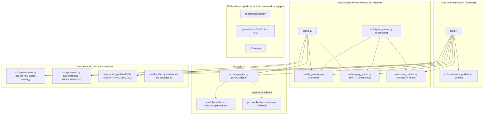
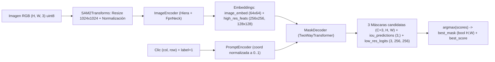

# HANDOFF TÉCNICO — SAM 2 GeoExtractor (`SAM2_STREAMLIT_APP`)

**Documento de Auditoría Técnica Completa e Informe de Continuidad para Claude**

---

## 1. Portada e Identificación del Proyecto

| Campo | Valor |
|---|---|
| **Nombre del Proyecto** | **SAM 2 GeoExtractor** (`SAM2_STREAMLIT_APP` / núcleo experimental `GEO-SAM`) |
| **Repositorio Git** | `https://github.com/stiagogomezt/sam2project` |
| **Aplicación Desplegada** | `https://sam2project-ic2ifnlunzwy8zq6cvd6et.streamlit.app/` |
| **Rama Git Activa** | `main` (sincronizada con `origin/main`) |
| **Último Commit** | `2cf0231` — *Fix: Add CPU torch and sam2 to requirements.txt and add resilient mock fallback in sam_engine* |
| **Commit Anterior** | `e2eac1a` — *feat: implement SAM 2 intelligent geospatial feature extraction app with modular architecture* |
| **Estado del Árbol de Trabajo** | Limpio (`nothing to commit, working tree clean`) |
| **Modificaciones Locales sin Publicar** | Ninguna (previo a la creación de este archivo `HANDOFF_CLAUDE.md`) |
| **Fecha de Auditoría** | 2026-11-15 |
| **Estado de Desarrollo** | Prototipo funcional v1 en Streamlit (`app.py` + `src/`) con un núcleo desacoplado de Fase 0 (`geosam/` + `cli/`) en desarrollo paralelo aún no conectado a la UI |

---

## 2. Resumen Ejecutivo

**SAM 2 GeoExtractor** es una aplicación geoespacial interactiva construida en **Python** y **Streamlit** que integra el modelo fundacional **Segment Anything Model 2 (SAM 2)** de Meta AI para la extracción semiautomática de objetos geográficos a partir de imágenes aéreas y satelitales de alta resolución (Esri World Imagery).

### Hallazgo Arquitectónico Principal
Durante la auditoría del repositorio se identificó que coexisten **dos arquitecturas**:
1. **Aplicación Activa (`app.py` + `src/` + `config.py`)**: Es la aplicación desplegada y operativa en Streamlit. Permite definir un Bounding Box (WGS84), descargar teselas XYZ de Esri World Imagery, ensamblar un mosaico georreferenciado en `EPSG:3857`, precalcular embeddings con SAM 2, capturar clics en un visor Folium/Leaflet, generar una máscara binaria, vectorizarla a polígono, calcular área ($\text{m}^2$) y perímetro ($\text{m}$) en CRS métrico (`EPSG:3116` o UTM), y exportar a GeoJSON, GeoTIFF, PNG y Shapefile.
2. **Núcleo Desacoplado Fase 0 (`geosam/` + `cli/` + `tests/unit/` + `docs/`)**: Arquitectura de nueva generación ("GEO-SAM") diseñada bajo decisiones de arquitectura formales (`docs/DECISIONES.md`), con protocolo `SegmentationBackend` (`SAM2Backend`, `SAM3Backend`, `MockBackend`), caché LRU SHA-256 (`EmbeddingCache`), persistencia SQLite con versionado inmutable de máscaras en RLE COCO (`GeoSamRepository`) y un CLI en Click (`cli/main.py`). **Actualmente `app.py` no utiliza `geosam/`**, salvo de forma indirecta cuando `src/sam_engine.py` cae en `MockBackend` ante ausencia de `torch` o `sam2`.

### Estado Crítico para Continuidad
- **Funcionamiento base**: El flujo punto-a-polígono está implementado en `app.py` y `src/`, pero presenta **riesgos críticos** en concurrencia de caché (`@st.cache_resource` compartido entre usuarios sobrescribe embeddings), **fallback silencioso a `MockBackend`**, pérdida de estado de mapa en `st.rerun()`, imposibilidad de gestionar múltiples objetos simultáneamente en la UI, y falta de conexión de `export_csv` y `geosam/` con la interfaz.
- **Pruebas en este entorno**: El entorno virtual `venv/` (Python 3.13.14 de Microsoft Store) fue bloqueado por el sandbox de Windows (`os error 1920`), por lo que la ejecución dinámica de `test_pipeline.py` y `pytest` queda marcada como `BLOCKED` en esta sesión y debe ejecutarse localmente antes de modificar código.

---

## 3. Objetivos y Conceptos Fundamentales del Proyecto

### 3.1 Objetivo General y Problema que Resuelve
Digitalizar manualmente coberturas urbanas, edificaciones, vías, cuerpos de agua o árboles sobre ortofotos en un SIG tradicional es lento y costoso. **SAM 2 GeoExtractor** resuelve este cuello de botella permitiendo al analista SIG hacer un clic sobre un objeto en el mapa web y obtener inmediatamente su máscara de segmentación, geometría vectorial georreferenciada y métricas reales en metros, listas para exportar a formatos SIG estándar.

### 3.2 Distinción Conceptual Rigurosa (Regla de Trabajo para Claude)
Para evitar errores de diseño o terminología en el desarrollo futuro, se establecen las siguientes fronteras técnicas:

| Concepto | Definición y Rol en el Proyecto |
|---|---|
| **Inteligencia Artificial (IA)** | Paradigma general de sistemas capaces de inferir patrones complejos. En este proyecto se materializa en el modelo fundacional **SAM 2** entrenado sobre SA-V / SA-1B. |
| **Visión por Computador** | Procesamiento digital de matrices de píxeles (RGB) para extraer información visual (redimensionamiento a 1024×1024, normalización, extracción de características Hiera/FPN, detección de bordes en `create_mask_overlay`). |
| **Segmentación (Promptable)** | Delimitación espacial de una **instancia** a nivel de píxel dado un prompt geométrico (punto, caja). **SAM 2 realiza segmentación agnóstica de clase, NO clasificación semántica.** |
| **Procesamiento Ráster** | Operaciones sobre matrices regulares de píxeles: ensamblado de teselas (`PIL.Image.paste`), recorte por bounding box, composición de canal alfa (RGBA) y escritura de GeoTIFF (`rasterio`). |
| **Georreferenciación** | Vinculación matemática entre índices de fila/columna $(row, col)$ y coordenadas espaciales del mundo real mediante una transformación afín (`rasterio.Affine`) y un CRS (`EPSG:3857`). |
| **Vectorización** | Conversión de la máscara ráster binaria `(H, W)` a primitivas geométricas vectoriales (`Polygon` / `MultiPolygon`) mediante `rasterio.features.shapes` y `shapely`. |
| **Análisis Geométrico** | Cálculo de propiedades métricas reales ($\text{m}^2$, $\text{m}$, centroide, compacidad, etc.) **obligatoriamente sobre un CRS proyectado métrico** (`EPSG:3116`, `EPSG:9377` o UTM), **nunca en grados decimales (`EPSG:4326`)**. |
| **Exportación GIS** | Serialización de geometrías, atributos y rásteres conservando CRS, metadatos y compatibilidad con software SIG (QGIS, ArcGIS) en GeoJSON, GeoTIFF, Shapefile, CSV o GeoPackage. |

---

## 4. Estado Actual y Auditoría del Repositorio

### 4.1 Árbol Real de Directorios

```text
sam2_streamlit_app/
├── .gitignore                      # Ignora venv/, *.pt, *.pth, *.tif, *.geojson, *.shp, .streamlit/
├── app.py                          # Aplicación principal Streamlit (449 líneas)
├── config.py                       # Constantes espaciales, URLs Esri y diccionario SAM2_MODELS (62 líneas)
├── requirements.txt                # Dependencias Python (CPU PyTorch + sam2 git + GIS + Streamlit)
├── README.md                       # Documentación general del proyecto (87 líneas)
├── test_app.py                     # Script mínimo "Hello World" de Streamlit (3 líneas, ignorado en git)
├── test_pipeline.py                # Suite de pruebas de integración del pipeline src/ (116 líneas)
├── sam2_hiera_tiny.pt              # Pesos SAM 2 Tiny locales (155,906,050 bytes — ignorado en git)
├── sam2_hiera_small.pt             # Pesos SAM 2 Small locales (184,309,650 bytes — ignorado en git)
├── sam2_hiera_large.pt             # Pesos SAM 2 Large locales (897,952,466 bytes — ignorado en git)
├── venv/                           # Entorno virtual Python 3.13.14 (ignorado en git)
├── models/                         # Directorio vacío
├── src/                            # Módulos activos consumidos por app.py
│   ├── tile_manager.py             # Validación BBOX y cálculo de teselas XYZ mercantile (114 líneas)
│   ├── imagery_loader.py           # Descarga HTTP concurrente con reintentos (74 líneas)
│   ├── mosaic_builder.py           # Ensamblado de teselas y transform afín 3857/4326 (47 líneas)
│   ├── highres_loader.py           # Adaptador retrocompatible (48 líneas)
│   ├── sam_engine.py               # Wrapper SAM2Engine + fallback MockBackend (161 líneas)
│   ├── segmentation.py             # coordinates_to_pixel, extract_cutout, create_mask_overlay (111 líneas)
│   ├── geospatial.py               # mask_to_geodataframe y cálculo métrico 3116/UTM (112 líneas)
│   ├── exporter.py                 # export_geojson, export_csv, export_png, export_geotiff, export_shapefile_zip (86 líneas)
│   ├── visualization.py            # create_geospatial_map con Folium (99 líneas)
│   └── classifier.py               # Clasificador NDVI/NDWI (128 líneas — NO usado en app.py)
├── cli/                            # CLI Click de GEO-SAM (stubs estructurales)
│   ├── __init__.py
│   └── main.py                     # Comandos: ingest, segment, metrics, validate, export (86 líneas)
├── docs/                           # Documentación de arquitectura y licencias
│   ├── DECISIONES.md               # ADRs DEC-0001 a DEC-0004 (41 líneas)
│   └── LICENCIAS.md                # Registro de licencias de modelos, librerías y datos (49 líneas)
├── examples/
│   └── demo_fase0.py               # Demo end-to-end del núcleo geosam/ con MockBackend y SQLite (136 líneas)
├── geosam/                         # Núcleo analítico desacoplado (Fase 0, no conectado a app.py)
│   ├── __init__.py                 # __version__ = "0.1.0"
│   ├── __main__.py
│   ├── backends/
│   │   ├── __init__.py
│   │   ├── protocol.py             # Protocolo SegmentationBackend, MaskCandidate, ImageEmbedding (103 líneas)
│   │   ├── cache.py                # EmbeddingCache LRU en RAM + compute_image_hash SHA-256 (72 líneas)
│   │   ├── sam2.py                 # SAM2Backend completo (points, box, mask, segment_everything) (266 líneas)
│   │   ├── sam3.py                 # SAM3Backend (esqueleto PCS, raise NotImplementedError / retorno []) (123 líneas)
│   │   └── mock.py                 # MockBackend determinista para CI sin GPU (207 líneas)
│   ├── store/
│   │   ├── __init__.py
│   │   ├── models.py               # Dataclasses: Project, ImageRecord, GeoObjectRecord, MaskVersionRecord, etc. (138 líneas)
│   │   ├── schema.py               # DDL SQLite/GeoPackage de 10 tablas (135 líneas)
│   │   └── repo.py                 # GeoSamRepository transaccional (401 líneas)
│   └── utils/
│       ├── __init__.py
│       └── rle.py                  # mask_to_rle y rle_to_mask orden Fortran estándar COCO (79 líneas)
└── tests/
    ├── __init__.py
    ├── conftest.py                 # Fixtures sample_image, mock_backend, memory_repo (34 líneas)
    └── unit/
        ├── test_cli.py             # Tests de ayuda y versión del CLI (32 líneas)
        ├── test_mock_backend.py    # Tests de MockBackend (64 líneas)
        ├── test_protocol.py        # Tests de protocolo y MaskCandidate (60 líneas)
        ├── test_rle.py             # Tests de roundtrip RLE COCO (45 líneas)
        └── test_store.py           # Tests de SQLite, versionado inmutable y borrado lógico (129 líneas)
```

> **Diferencia respecto a la lista esperada**: Además de los módulos base en `src/`, existen `src/classifier.py` (no integrado), `test_app.py`, `cli/`, `docs/`, `examples/`, `geosam/` y `tests/unit/`. No existen archivos `__init__.py` en `src/`.

---

## 5. Arquitectura del Sistema



---

## 6. Auditoría Detallada por Módulos

### 6.1 Módulos Principales (`app.py`, `config.py`, `test_pipeline.py`)

| Archivo | Responsabilidad | Funciones / Clases | Imports Clave | Estado |
|---|---|---|---|---|
| `config.py` | Centralizar constantes BBOX, límites de teselas, URL Esri, configs SAM 2 y CRS | Sin funciones/clases; define `BASE_DIR`, `DEFAULT_BBOX`, `MAX_TILES_LIMIT=100`, `WARNING_TILES_LIMIT=40`, `ESRI_IMAGERY_URL`, `SAM2_MODELS`, `CRS_*` | `pathlib.Path` | Completo. Usa `EPSG:3116` mientras `geosam` usa `EPSG:9377`. |
| `app.py` | Orquestar UI Streamlit, sesión, descarga de mosaico, clics en Folium, validación y descargas | Script procedural con `st.session_state` (`mosaic_data`, `embeddings_computed`, `candidate_result`, `accepted_result`, `last_processed_click`, `map_center`) | `streamlit`, `streamlit_folium`, `numpy`, `PIL`, `config`, `src.*` | Funcional para 1 objeto. No conecta `export_csv`, no gestiona múltiples objetos, bug en `Descartar/Reintentar` y en `@st.cache_resource` compartido. |
| `test_pipeline.py` | Pruebas unitarias/integración sin SAM 2 ni red HTTP | `test_tile_manager()`, `test_pixel_mapping_accuracy()`, `test_geospatial_vectorization_and_metrics()`, `test_exporters()` | `numpy`, `PIL`, `mercantile`, `rasterio`, `config`, `src.*` | Completo para `src/`, pero no prueba `sam_engine.py` ni `imagery_loader.py` ni `app.py`. |

### 6.2 Módulos de `src/`

1. **`src/tile_manager.py`**
   - **Responsabilidad**: Validar BBOX en WGS84 y calcular teselas XYZ, dimensiones, tamaño estimado y GSD aproximado.
   - **Clases/Funciones**: `TileManagerError(Exception)`, `validate_bbox(...)`, `get_tiles_info(...)`.
   - **Entradas/Salidas**: Recibe `(min_lon, min_lat, max_lon, max_lat, zoom)` → retorna diccionario con `tiles`, `num_tiles`, `grid_shape`, `pixel_shape`, `estimated_mb`, `res_m_per_px`, `centroid`, `bounds_3857`, `bounds_4326`, `tile_range`, `is_large`.
   - **Estado**: Completo y sólido.

2. **`src/imagery_loader.py`**
   - **Responsabilidad**: Descarga multihilo de teselas con reintentos HTTP.
   - **Funciones**: `_create_session()`, `download_single_tile()`, `download_tiles_concurrently(tiles, progress_callback, max_workers=8, url_template)`.
   - **Problemas conocidos**: Si falla HTTP o hay excepción, devuelve una tesela gris neutra `(40, 40, 40)` silenciosamente sin registrar qué teselas fallaron ni alertar al usuario. Sin caché en disco.

3. **`src/mosaic_builder.py`**
   - **Responsabilidad**: Pegar teselas 256×256 en un lienzo continuo y calcular transformaciones afines.
   - **Funciones**: `build_mosaic(tiles_info, tile_images)`.
   - **Salidas**: Dict con `img_array` (`uint8 HxWx3`), `pil_image`, `width`, `height`, `transform_3857`, `transform_4326`, `bounds_3857`, `bounds_4326`, `tiles_info`.
   - **Estado**: Completo.

4. **`src/highres_loader.py`**
   - **Responsabilidad**: Fachada retrocompatible sobre `tile_manager`, `imagery_loader` y `mosaic_builder`.
   - **Funciones**: `get_highres_image(...)`, `get_highres_mosaic_bundle(...)`.
   - **Estado**: No usado por `app.py`, mantenido por retrocompatibilidad.

5. **`src/sam_engine.py`**
   - **Responsabilidad**: Wrapper de `SAM2ImagePredictor` con descarga automática de pesos, selección CUDA/CPU y fallback a `MockBackend`.
   - **Clases/Funciones**: `SAM2Engine`, `get_sam2_engine(model_key)` decorada con `@st.cache_resource`.
   - **Incompleto/Problemas**: Solo expone `predict_point(col, row, multimask_output=True)` con 1 punto positivo; no expone puntos negativos, cajas, `mask_input` ni selección manual entre las 3 máscaras candidatas. El singleton `@st.cache_resource` muta `self.predictor._features` globalmente entre sesiones.

6. **`src/segmentation.py`**
   - **Responsabilidad**: Conversión coordenada→píxel, recorte RGBA y overlay visual.
   - **Funciones**: `coordinates_to_pixel(lon, lat, transform_3857, width, height)`, `extract_cutout(img_array, mask, crop_to_bbox=True, padding=10)`, `create_mask_overlay(...)`.
   - **Estado**: Completo y preciso (`mercantile.xy` + `rasterio.transform.rowcol`).

7. **`src/geospatial.py`**
   - **Responsabilidad**: Vectorización de máscara binaria, unión topológica, reproyección y métricas en metros.
   - **Funciones**: `mask_to_geodataframe(mask, transform_3857, confidence=1.0, min_pixel_area=4)`.
   - **Problemas**: El parámetro `min_pixel_area=4` no se utiliza en el cuerpo de la función; `datetime.utcnow()` está deprecado en Python ≥3.12; usa `EPSG:3116` en lugar de `EPSG:9377` (origen nacional oficial en Colombia según `docs/DECISIONES.md`).

8. **`src/exporter.py`**
   - **Responsabilidad**: Serializar resultados a formatos descargables.
   - **Funciones**: `export_geojson`, `export_csv`, `export_png`, `export_geotiff`, `export_shapefile_zip`.
   - **Problemas**: `export_csv` no está conectado en `app.py`; `export_shapefile_zip` truncará nombres de columnas >10 caracteres (ej. `centroid_lat` y `centroid_lon` colisionan a `centroid_l`); no existe exportador GeoPackage.

9. **`src/visualization.py`**
   - **Responsabilidad**: Construir el mapa Folium interactivo.
   - **Funciones**: `create_geospatial_map(...)`.
   - **Problemas**: `subdomains=["server", "services"]` pasado a `TileLayer` aunque la URL `server.arcgisonline.com` no contiene `{s}`; el mapa se reconstruye completo en cada `st.rerun()` reiniciando zoom/centro.

10. **`src/classifier.py`**
    - **Responsabilidad**: Clasificación espectral NDVI/NDWI (`classify_polygons`, `spectral_profiler`).
    - **Estado**: **Módulo huérfano** (no importado en ningún archivo). Asume imágenes multiespectrales de 4 bandas (Blue, Green, Red, NIR), incompatible con teselas RGB de 3 bandas de Esri World Imagery.

### 6.3 Módulos de `geosam/`, `cli/`, `examples/` y `tests/`
- **`geosam/backends/protocol.py`**: Define `MaskCandidate`, `ImageEmbedding` y el protocolo `@runtime_checkable SegmentationBackend`.
- **`geosam/backends/sam2.py`**: Implementa `SAM2Backend` completo (`load`, `embed` con `EmbeddingCache`, `predict_points`, `predict_box`, `predict_mask`, `segment_everything`).
- **`geosam/backends/sam3.py`**: Esqueleto para SAM 3; `predict_points/box/mask` lanzan `NotImplementedError` y `predict_concept`/`segment_everything` retornan `[]`.
- **`geosam/backends/cache.py`**: `EmbeddingCache` LRU en RAM (hasta 16 entradas, respaldo en disco definido en `self.cache_dir` pero **no implementado** en `get`/`put`).
- **`geosam/backends/mock.py`**: `MockBackend` determinista para pruebas sin GPU.
- **`geosam/store/{models.py, schema.py, repo.py}`**: Persistencia SQLite completa con 10 tablas (`project`, `image`, `session`, `prompt`, `mask_version`, `object`, `object_metric`, `validation`, `change_link`, `export_log`), versionado inmutable y borrado lógico (`status='rechazado'`).
- **`geosam/utils/rle.py`**: Codificación/decodificación RLE COCO en orden Fortran.
- **`cli/main.py`**: CLI Click (`ingest`, `segment`, `metrics`, `validate`, `export`), actualmente solo imprime mensajes (`click.echo`) sin lógica conectada.

---

## 7. Auditoría del Motor de Inteligencia Artificial (SAM 2)

### 7.1 Modelo Real Verificado
Verificado directamente en `config.py` y `venv/Lib/site-packages/sam2/configs/sam2/`:
- **Arquitectura**: **SAM 2** (lanzamiento `072824`, NO SAM 2.1). Clase base `sam2.modeling.sam2_base.SAM2Base`.
- **Variantes configuradas en `config.py`**:
  1. `sam2_hiera_tiny` (por defecto): Config `configs/sam2/sam2_hiera_t.yaml` (`Hiera` `embed_dim=96`, `num_heads=1`, `stages=[1, 2, 7, 2]`). Checkpoint local `sam2_hiera_tiny.pt` (**155.9 MB**).
  2. `sam2_hiera_small`: Config `configs/sam2/sam2_hiera_s.yaml` (`Hiera` `embed_dim=96`, `num_heads=1`, `stages=[1, 2, 11, 2]`). Checkpoint local `sam2_hiera_small.pt` (**184.3 MB**).
  3. `sam2_hiera_large`: Config `configs/sam2/sam2_hiera_l.yaml` (`Hiera` `embed_dim=144`, `num_heads=2`, `stages=[2, 6, 36, 4]`). Checkpoint local `sam2_hiera_large.pt` (**897.9 MB**).
- **Fuente de pesos**: `https://dl.fbaipublicfiles.com/segment_anything_2/072824/<variante>.pt` (descarga automática vía `urllib.request.urlretrieve` si no existe localmente).
- **Conteo de parámetros**: No verificado en ejecución por bloqueo de `python.exe` en el sandbox.
- **Dispositivo y PyTorch**: `requirements.txt` especifica `--extra-index-url https://download.pytorch.org/whl/cpu` y `torch>=2.2.0`. En `venv/` está instalado **`torch-2.14.0+cpu`** y **`sam_2-1.0`**. `SAM2Engine.__init__` usa `"cuda" if torch.cuda.is_available() else "cpu"`.

### 7.2 Arquitectura de Inferencia



- **Image Encoder (`set_image`)**: Redimensiona la imagen a `1024×1024` (`image_size: 1024` en YAML), ejecuta el backbone jerárquico `Hiera` + `FpnNeck`, añade `no_mem_embed` y guarda `self.predictor._features = {"image_embed": ..., "high_res_feats": ...}`.
- **Prompt Encoder & Mask Decoder (`predict`)**: En `src/sam_engine.py`, se llama `self.predictor.predict(point_coords=[[col, row]], point_labels=[1], box=None, mask_input=None, multimask_output=True)`. El predictor normaliza `(col, row)` internamente (`normalize_coords=True` por defecto) y retorna `(masks, scores, logits)`.

### 7.3 Embeddings y Caching
- **Cuándo se calculan**: En `app.py` línea 190, inmediatamente tras ensamblar el mosaico (`engine.set_image(mosaic["img_array"])`).
- **Cómo se almacenan y reutilizan**: Se almacenan en memoria RAM dentro del atributo privado `self.predictor._features` de la instancia `SAM2Engine` cacheada por `@st.cache_resource`. **No se recalculan al hacer clic** sobre la misma imagen (solo se ejecuta el Mask Decoder, logrando baja latencia).
- **Qué ocurre al cambiar de imagen**: `engine.set_image(...)` llama `self.predictor.reset_predictor()` y sobrescribe `_features`.
- **Riesgo Crítico**: `@st.cache_resource` es **global al servidor Streamlit**, no por sesión de usuario (`st.session_state`). En despliegues multiusuario, un usuario sobrescribe los embeddings del otro.

### 7.4 Prompts Implementados vs. Pendientes

| Tipo de Prompt | `src/sam_engine.py` + `app.py` | `geosam/backends/sam2.py` |
|---|---|---|
| **Point Prompt (1 punto positivo)** | ✅ Implementado y activo | ✅ Implementado (`predict_points`) |
| **Múltiples puntos positivos** | ❌ No implementado (`[[col, row]]` fijo) | ✅ Implementado |
| **Negative Points (label=0)** | ❌ No implementado | ✅ Implementado |
| **Box Prompt (XYXY)** | ❌ No implementado (`box=None`) | ✅ Implementado (`predict_box`) |
| **Mask Prompt (Refinamiento iterativo)** | ❌ No implementado (`mask_input=None`) | ✅ Implementado (`predict_mask`) |

### 7.5 Resultados y Significado del Score
- **Número de candidatos**: Con `multimask_output=True`, SAM 2 genera **3 máscaras candidatas** `(3, H, W)` (escala pequeña, media y completa para resolver ambigüedad de 1 solo clic).
- **Umbral de binarización**: `SAM2ImagePredictor` aplica `mask_threshold=0.0` sobre los logits para devolver máscaras binarias (en `src/sam_engine.py` `return_logits` queda en `False` por defecto, por lo que `masks` ya viene binarizado y se convierte a `bool`; los `logits` de salida tienen forma `(3, 256, 256)` y no se conservan en `candidate_result`).
- **Selección**: `best_idx = int(np.argmax(scores))`. Las otras 2 máscaras se devuelven en `all_masks` pero la UI no permite elegir entre ellas.
- **Significado del Score**: El valor retornado en `scores` corresponde a **`iou_predictions`** — la estimación que hace el Mask Decoder de la **Intersección sobre Unión (IoU)** esperada entre la máscara predicha y la máscara real del objeto. **NO es una probabilidad de clasificación semántica** (aunque `app.py` lo muestra como `"Confianza SAM 2"` en porcentaje).

---

## 8. Bibliotecas y Dependencias

Tabla contrastada entre `requirements.txt` y los directorios `.dist-info` instalados en `venv/Lib/site-packages/`:

| Biblioteca | Versión Requerida (`requirements.txt`) | Versión Instalada (`venv/`) | Función en el Proyecto | Estado |
|---|---|---|---|---|
| **Python** | N/A | `3.13.14` (según `pyvenv.cfg`) | Intérprete base | ⚠️ `WindowsApps` bloqueado en sandbox |
| **torch** | `>=2.2.0` (index CPU) | `2.14.0+cpu` | Motor tensorial PyTorch para SAM 2 | ✅ Instalado (CPU) |
| **torchvision** | sin pin | `0.29.0+cpu` | Transformaciones de visión requeridas por SAM 2 | ✅ Instalado (CPU) |
| **sam2** | `git+https://github.com/facebookresearch/sam2.git` | `sam_2-1.0` | Modelo Segment Anything 2 | ✅ Instalado |
| **numpy** | implícita | `2.5.2` | Álgebra matricial y máscaras | ✅ Instalado |
| **pillow** | implícita | `12.3.0` | Ensamblado de teselas, PNG, bordes | ✅ Instalado |
| **streamlit** | sin pin | `1.63.0` | Framework UI web | ✅ Instalado |
| **streamlit-folium** | sin pin | `0.27.4` | Componente Leaflet en Streamlit | ✅ Instalado |
| **folium** | sin pin | `0.20.0` | Generación de mapas Leaflet | ✅ Instalado |
| **mercantile** | sin pin | `1.2.1` | Teselas XYZ y proyección `xy` EPSG:3857 | ✅ Instalado |
| **rasterio** | sin pin | `1.5.1` | Transform afín, vectorización `shapes`, GeoTIFF | ✅ Instalado |
| **geopandas** | sin pin | `1.1.4` | GeoDataFrames, reproyección, Shapefile/GeoJSON | ✅ Instalado |
| **shapely** | sin pin | `2.1.2` | Geometrías vectoriales y `unary_union` | ✅ Instalado |
| **pyproj** | implícita | `3.8.0` | Motor de CRS y proyecciones | ✅ Instalado |
| **hydra-core** | implícita (sam2) | `1.3.6` | Carga de YAMLs de configuración SAM 2 | ✅ Instalado |
| **iopath** | implícita (sam2) | `0.1.10` | I/O requerido por SAM 2 | ✅ Instalado |
| **requests** | sin pin | `2.34.2` | Descarga HTTP de teselas | ✅ Instalado |
| **click** | sin pin | `8.5.0` | CLI `cli/main.py` | ✅ Instalado |
| **pydantic** | sin pin | `2.13.5` | Listado en `requirements.txt` (sin uso actual) | ✅ Instalado |
| **pyyaml** | sin pin | `6.0.3` | Soporte YAML | ✅ Instalado |
| **pytest** | no en requirements | `9.1.1` | Suite de pruebas unitarias | ✅ Instalado en `venv` |

- **Sistema Operativo**: Windows.
- **GPU / CUDA**: No hay PyTorch CUDA instalado en `venv/` (`+cpu`); inferencia configurada para CPU.

---

## 9. Flujo de Adquisición y Procesamiento de Imágenes

```text
BBOX (WGS84: min_lon, min_lat, max_lon, max_lat) + Zoom (14..19)
  └─> src/tile_manager.py: get_tiles_info()
        ├─ Valida rangos [-180,180], [-85.0511,85.0511], área >= 1e-5°
        ├─ Calcula teselas XYZ vía mercantile.tiles(...)
        ├─ Aplica límite duro MAX_TILES_LIMIT = 100 (alerta si > 40)
        └─ Calcula bounds_3857 exactos de la grilla de teselas (múltiplos de 256 px)
  └─> src/imagery_loader.py: download_tiles_concurrently()
        ├─ Proveedor: Esri World Imagery (ArcGIS MapServer tile/{z}/{y}/{x})
        ├─ ThreadPoolExecutor(max_workers=8) + Retry(total=3, backoff=0.5, [429,500,502,503,504])
        └─ Timeout 12s; ante fallo HTTP retorna tesela gris (40,40,40)
  └─> src/mosaic_builder.py: build_mosaic()
        ├─ Lienzo RGB (tiles_x * 256, tiles_y * 256)
        ├─ Pega cada tesela en ((tile.x - min_x)*256, (tile.y - min_y)*256)
        ├─ Calcula transform_3857 = from_bounds(w_m, s_m, e_m, n_m, width_px, height_px)
        └─ Calcula transform_4326 = from_bounds(w_deg, s_deg, e_deg, n_deg, width_px, height_px)
```

### Coherencia Visor vs. SAM 2
- Tanto Folium como `imagery_loader.py` consumen el mismo endpoint de **Esri World Imagery** en **EPSG:3857**.
- **Matiz importante**: El mosaico procesado por SAM 2 tiene resolución fija correspondiente al `zoom_level` descargado (ej. Zoom 18 ≈ `0.597 m/px` en el ecuador), mientras que en el visor Folium (`max_zoom=20`) el usuario puede hacer zoom hasta nivel 19 o 20 viendo teselas más detalladas que las que realmente contiene `mosaic["img_array"]`.

---

## 10. Interacción entre Leaflet y SAM 2 (Paso a Paso)

1. **Captura del clic**: `st_folium(map_obj, ..., returned_objects=["last_clicked"])` (`app.py:242-247`) captura `{"lat": float, "lng": float}` en **WGS84 (`EPSG:4326`)**.
2. **Deduplicación y validación**: Se redondea a 6 decimales (`current_click = (round(click_lat, 6), round(click_lon, 6))`) y se valida `s_deg <= click_lat <= n_deg and w_deg <= click_lon <= e_deg` (`app.py:256-263`).
3. **Proyección a Web Mercator**: `coordinates_to_pixel()` (`src/segmentation.py:22`) ejecuta `xm, ym = mercantile.xy(lon, lat)` obteniendo coordenadas métricas en `EPSG:3857`.
4. **Transformación Afín inversa (cálculo de fila y columna + eje Y)**:
   `row_f, col_f = rasterio.transform.rowcol(transform_3857, xm, ym)` (`src/segmentation.py:23`), seguido de `row, col = int(np.round(row_f)), int(np.round(col_f))`.
   Dado que `from_bounds(w_m, s_m, e_m, n_m, width_px, height_px)` construye una matriz afín con resolución Y negativa (`e = -(n_m - s_m) / height_px`), `rowcol` invierte automáticamente el eje Y (Norte arriba = `row 0`, Sur abajo = `row height-1`), eliminando la distorsión no lineal de latitud de Mercator.
5. **Validación de límites**: Verifica `0 <= col < width and 0 <= row < height`.
6. **Entrega a SAM 2**: `engine.predict_point(col, row)` (`src/sam_engine.py:130-139`) construye `point_coords = np.array([[col, row]], dtype=np.float32)` (convención `(X, Y)` = `(col, row)` esperada por `SAM2ImagePredictor.predict`).

### Riesgos de Interacción Detectados
- **Zoom/Pan reset**: Cada clic válido ejecuta `st.rerun()` (`app.py:305`), reconstruyendo `create_geospatial_map` con `zoom_start=18` y `center=st.session_state.map_center`. El usuario pierde su nivel de zoom y encuadre tras cada clic.
- **Descartar / Reintentar**: Al pulsar `🔄 Descartar / Reintentar` (`app.py:335-339`), se limpia `last_processed_click = None` pero `st_folium` puede seguir reteniendo el último `last_clicked` en el estado del componente cliente, re-disparando la inferencia sobre el mismo punto descartado.

---

## 11. Transformación Geoespacial (`src/geospatial.py`)

Flujo verificado en `mask_to_geodataframe()` (`src/geospatial.py:15-112`):
1. **Vectorización**: `rasterio.features.shapes(mask.astype(np.uint8), transform=transform_3857)` extrae polígonos en **`EPSG:3857`**, filtrando `val == 1`, `geom.is_valid`, `not geom.is_empty` y `geom.area > 0`.
2. **Fusión**: `unary_union(polygons)` unifica componentes conexos en un `Polygon` o `MultiPolygon`.
3. **Reproyección a WGS84**: `gdf_3857.to_crs("EPSG:4326")` para almacenamiento compatible con Leaflet/GeoJSON.
4. **Selección de CRS Métrico** (nunca se mide en grados):
   - Si el centroide cae en Colombia (`-79.5 <= centroid_lon <= -66.5` y `-4.5 <= centroid_lat <= 13.5`): usa **`EPSG:3116`** (MAGNA-SIRGAS / Colombia Bogotá zone). *(Nota: `geosam/` y `docs/DECISIONES.md` especifican `EPSG:9377` Origen Nacional; esta divergencia debe unificarse).*
   - Fuera de Colombia: usa `gdf_4326.estimate_utm_crs()`.
5. **Cálculo de Métricas**: Sobre `gdf_metric = gdf_4326.to_crs(metric_crs)` calcula `area_m2 = float(gdf_metric.area.iloc[0])` y `perimeter_m = float(gdf_metric.length.iloc[0])`.

---

## 12. Estructura de Datos y Objetos

En `app.py`, cada objeto segmentado se mantiene en `st.session_state.candidate_result` (en evaluación) o `st.session_state.accepted_result` (confirmado) como un diccionario con:
- `mask` (`np.ndarray` bool `(H, W)`), `gdf` (`gpd.GeoDataFrame` de 1 fila), `score` (`float`), `inference_time` (`float`), `device` (`str`), `click_latlon`, `pixel_colrow`, `cutout_image` (`PIL.Image` RGBA), `overlay_array` (`np.ndarray` RGB), `bbox_px`.

Atributos reales del `GeoDataFrame` (`src/geospatial.py:95-110`):
- `object_id` (`OBJ-XXXXXXXX` vía `uuid4().hex[:8].upper()`), `label` (fijo: `"Objeto segmentado mediante SAM 2"`), `confidence` (score IoU redondeado a 4 dec.), `area_m2`, `perimeter_m`, `centroid_lat`, `centroid_lon`, `min_lon`, `min_lat`, `max_lon`, `max_lat`, `metric_crs`, `timestamp` (ISO UTC), `geometry`.

**Limitación actual**: `app.py` solo conserva **1 objeto aceptado** (`accepted_result`); aceptar otro objeto sobrescribe el anterior. El soporte multi-objeto con historial inmutable existe únicamente en `geosam/store/repo.py` (no conectado).

---

## 13. Auditoría de Exportación (`src/exporter.py`)

| Formato | ¿Implementado en `exporter.py`? | Función | CRS | ¿Conectado en `app.py`? | ¿Probado en esta sesión? | Problemas conocidos |
|---|---|---|---|---|---|---|
| **GeoJSON** | ✅ Sí | `export_geojson(gdf)` | `EPSG:4326` | ✅ Sí | ❌ `BLOCKED` (sandbox) | Ninguno crítico |
| **GeoTIFF** | ✅ Sí | `export_geotiff(...)` | `EPSG:3857` | ✅ Sí | ❌ `BLOCKED` (sandbox) | Exporta el mosaico completo con canal alfa (4 bandas RGBA) |
| **PNG Transparente** | ✅ Sí | `export_png(pil_image)` | N/A (píxel) | ✅ Sí | ❌ `BLOCKED` (sandbox) | Sin georreferenciación (solo recorte RGBA) |
| **Shapefile (.zip)** | ✅ Sí | `export_shapefile_zip(gdf)` | `EPSG:4326` | ✅ Sí | ❌ `BLOCKED` (sandbox) | Truncamiento DBF a 10 chars (`centroid_lat`/`centroid_lon` colisionan a `centroid_l`) |
| **CSV** | ✅ Sí | `export_csv(gdf)` | N/A (tabular) | ❌ **No** | ❌ `BLOCKED` (sandbox) | Falta botón de descarga en `app.py` |
| **GeoPackage (.gpkg)** | ❌ No | — | — | ❌ No | — | Solo declarado como opción en `cli/main.py` |

---

## 14. Interfaz y Experiencia de Usuario (`app.py`, `visualization.py`)

- **Sidebar**:
  1. *Motor de IA*: Selector de modelo (`Tiny`, `Small`, `Large`), badge de dispositivo (`GPU` verde / `CPU` amarillo).
  2. *Zona de Estudio (BBOX)*: 4 `number_input` (`min_lon`, `min_lat`, `max_lon`, `max_lat`), slider de zoom (`14–19`), caja informativa con conteo de teselas, resolución y tamaño estimado, y botón primario `📥 Descargar y Cargar Ortofoto`.
- **Panel Principal**:
  - Visor `st_folium` (ancho 100%, alto 550px) con capa Esri Satelital, `MousePosition`, barra de escala, rectángulo rojo punteado de límites, máscara cian y marcador rojo/dorado del clic.
  - Panel de validación (`✅ Aceptar Objeto` / `🔄 Descartar / Reintentar`).
  - Panel de resultados con 4 tarjetas (`Superficie`, `Perímetro`, `Confianza SAM 2`, `Tiempo Inferencia`) y 3 pestañas (`Atributos y Coordenadas`, `Objeto Extraído (Canal Alfa)`, `Centro de Exportación`).

---

## 15. Pruebas y Validación

En este entorno sandboxed de Windows, `.\venv\Scripts\python.exe` apunta a una instalación de Python 3.13 en `WindowsApps` bloqueada por el sistema (`os error 1920`), por lo que **no fue posible ejecutar código Python con las dependencias del `venv`**.

| Paso / Prueba | Estado | Evidencia / Motivo |
|---|---|---|
| `test_pipeline.py` (4 tests de integración `src/`) | `BLOCKED` | Python de `venv` inaccesible en sandbox (`os error 1920`) |
| `pytest tests/unit/` (5 archivos de tests `geosam/`) | `BLOCKED` | `pytest` no disponible fuera de `venv` |
| 1. Inicio de Streamlit (`streamlit run app.py`) | `NOT TESTED` | Bloqueado por `venv` |
| 2. Carga de SAM 2 (`.pt` locales) | `NOT TESTED` | Bloqueado por `venv` |
| 3–11. Flujo completo UI (imagen → clic → píxel → inferencia → vectorización → exportación) | `NOT TESTED` | Requiere ejecución interactiva fuera de sandbox |

---

## 16. Auditoría del Despliegue

- **URL**: `https://sam2project-ic2ifnlunzwy8zq6cvd6et.streamlit.app/`
- **Estado**: **No verificable desde este entorno**. El sandbox no tiene acceso a red externa ni a los logs de Streamlit Community Cloud.
- **Análisis estático de riesgos para el despliegue**:
  - `requirements.txt` incluye `--extra-index-url https://download.pytorch.org/whl/cpu`, `torch>=2.2.0`, `torchvision`, y `git+https://github.com/facebookresearch/sam2.git`.
  - Si `sam2` o `torch` fallan o tardan en instalarse, `src/sam_engine.py` activa `MockBackend` silenciosamente.
  - Los archivos `.pt` no están en Git (`.gitignore`), por lo que Streamlit Cloud debe descargar `sam2_hiera_tiny.pt` (~156 MB) en tiempo de ejecución desde `dl.fbaipublicfiles.com` al directorio de la app (donde pueden no persistir entre reinicios del contenedor). El modelo `Large` (~898 MB) puede exceder el límite de RAM (~1 GB) del tier gratuito de Streamlit Cloud.

---

## 17. Problemas Detectados y Deuda Técnica

### CRÍTICOS
1. **Estado global de embeddings en `@st.cache_resource` (`src/sam_engine.py:158-161`, `app.py:118,190`)**:
   - *Causa*: `SAM2Engine` es un singleton compartido entre todas las sesiones de usuario y almacena el estado de la imagen en `self.predictor._features`.
   - *Consecuencia*: En uso concurrente, un usuario sobrescribe los embeddings de otro, produciendo máscaras sobre la imagen equivocada.
   - *Solución*: Almacenar los embeddings (`_features`, `_orig_hw`) en `st.session_state` por usuario (o usar `EmbeddingCache` indexado por `image_hash` como en `geosam/backends/sam2.py`) y restaurarlos antes de `predict()`.
2. **Fallback silencioso a `MockBackend` (`src/sam_engine.py:31-41`)**:
   - *Causa*: Ante cualquier `ImportError` de `torch` o `sam2`, `SAM2Engine` activa máscaras circulares sintéticas sin levantar alerta prominente en `app.py`.
   - *Consecuencia*: El usuario puede creer que segmenta con IA real cuando obtiene círculos simulados.
   - *Solución*: Mostrar `st.error` o `st.warning` explícito en `app.py` cuando `getattr(engine, "is_mock", False)` sea `True`.

### ALTOS
3. **Pérdida de zoom/centro y re-disparo al descartar en Folium (`app.py:234-247, 305, 335-339`)**:
   - *Causa*: `zoom_start=18` fijo y `st.rerun()` reconstruyen el mapa; al descartar se limpia `last_processed_click = None` mientras `st_folium` aún retiene `last_clicked`.
   - *Solución*: Persistir zoom/centro desde `map_interaction` y rastrear un `discarded_click` o timestamp/hash de evento para no re-procesar el clic descartado.
4. **Sobrescritura de objetos aceptados (`app.py:329`)**:
   - *Causa*: `st.session_state.accepted_result = candidate` guarda solo 1 objeto.
   - *Solución*: Migrar a una lista/colección de objetos o conectar `geosam/store/repo.py`.
5. **Desalineación potencial de zoom entre visor y mosaico (`src/visualization.py:39`, `app.py:142`)**:
   - *Causa*: El mapa permite `max_zoom=20` aunque el mosaico se descargue a zoom 14–19.
   - *Solución*: Sincronizar o advertir al usuario la resolución real de trabajo.

### MEDIOS
6. **Divergencia de CRS métrico colombiano (`config.py:62` vs `docs/DECISIONES.md`)**: `src/geospatial.py` usa `EPSG:3116`, mientras `geosam/` y `DECISIONES.md` definen `EPSG:9377` (MAGNA-SIRGAS Origen Nacional).
7. **Truncamiento de columnas en Shapefile (`src/exporter.py:77`)**: `centroid_lat` y `centroid_lon` superan 10 caracteres y colisionan en DBF.
8. **`export_csv` desconectado en `app.py`** y **`min_pixel_area` sin usar en `src/geospatial.py:19`**.
9. **Módulo huérfano `src/classifier.py`** incompatible con imágenes RGB de 3 bandas.
10. **Teselas fallidas en `src/imagery_loader.py:41`** se reemplazan por cuadros grises sin notificar cuántas fallaron.

### BAJOS
11. `datetime.utcnow()` deprecado en `src/geospatial.py:92`.
12. `subdomains=["server", "services"]` innecesario en `src/visualization.py:40`.
13. `EmbeddingCache` en `geosam/backends/cache.py` declara `cache_dir` en disco pero solo implementa caché en RAM.

---

## 18. Plan de Continuidad para Claude (Roadmap Priorizado)

| Fase | Tareas Clave | Prioridad | Archivos a Modificar | Complejidad / Riesgos | Criterios de Aceptación y Pruebas |
|---|---|---|---|---|---|
| **Fase 1: Estabilización** | 1) Aislar embeddings por sesión (`st.session_state`). 2) Advertir si `is_mock=True`. 3) Corregir bug de `Descartar/Reintentar` y pérdida de zoom en `st_folium`. 4) Conectar `export_csv` y arreglar nombres Shapefile. 5) Activar filtro `min_pixel_area`. | **P0 (Crítica)** | `app.py`, `src/sam_engine.py`, `src/geospatial.py`, `src/exporter.py` | Media. Riesgo: comportamiento de re-renderizado de `streamlit-folium`. | `test_pipeline.py` 100% PASS; prueba manual de 2 clics + descartar sin re-disparo. |
| **Fase 2: Segmentación Avanzada** | Exponer en `sam_engine.py` y `app.py`: puntos positivos/negativos acumulados, selector entre las 3 máscaras candidatas (`all_masks`), Box prompt y refinamiento iterativo (`mask_input` con `logits`). | **P1 (Alta)** | `src/sam_engine.py`, `app.py` (o migrar a `geosam/backends/sam2.py`) | Media-Alta. Riesgo: UX de múltiples clics en Folium. | Pruebas con puntos +/- y selección de candidato en `SAM2Backend` / `SAM2Engine`. |
| **Fase 3: Administrador de Objetos** | Lista de objetos aceptados en sesión (con IDs únicos, etiqueta editable, mostrar/ocultar en Folium, eliminar), idealmente respaldado por `geosam/store/repo.py` y `rle.py`. | **P1 (Alta)** | `app.py`, `src/visualization.py`, `geosam/store/repo.py` | Media. | Múltiples polígonos simultáneos en mapa y exportación conjunta. |
| **Fase 4: Análisis Geométrico** | Calcular compacidad, rectangularidad, elongación, orientación y convex hull en CRS métrico (`EPSG:9377` / UTM) alineando `src/geospatial.py` con `ObjectMetricRecord`. | **P2 (Media)** | `src/geospatial.py`, `geosam/store/models.py` | Baja-Media. | Tests unitarios verificando métricas sobre rectángulos/círculos sintéticos en metros. |
| **Fase 5: Explotación Geoespacial** | Exportación GeoPackage (`.gpkg`), catálogo de objetos, estadísticas agregadas en UI y conexión del CLI `cli/main.py`. | **P2 (Media)** | `src/exporter.py`, `app.py`, `cli/main.py` | Media. | Exportación `.gpkg` válida legible por `geopandas.read_file`. |
| **Fase 6: IA Avanzada** | `SAM2AutomaticMaskGenerator` (`segment_everything`), integración `SAM3Backend`, exportación COCO/YOLO y análisis multitemporal. | **P3 (Baja)** | `geosam/backends/*`, `src/exporter.py`, `app.py` | Alta (consumo CPU/RAM). | Benchmarks de memoria y tiempo en CPU. |

---

## 19. Documentación Visual

- No se encontraron archivos de imagen (`.png`, `.jpg`, `.svg`, `.gif`) ni capturas de pantalla almacenados dentro del repositorio (excluyendo `venv/` y `.git/`).
- La arquitectura visual del proyecto se documenta mediante los diagramas Mermaid de las secciones **5** y **7.2**.

---

## 20. Guía de Reproducibilidad

### Windows PowerShell
```powershell
# 1. Clonar o abrir el repositorio
git clone https://github.com/stiagogomezt/sam2project.git
cd sam2project

# 2. Crear y activar entorno virtual
python -m venv venv
.\venv\Scripts\Activate.ps1

# 3. Instalar dependencias (CPU PyTorch + SAM 2 + GIS)
pip install -r requirements.txt

# 4. Verificar PyTorch y CUDA
python -c "import torch; print('PyTorch:', torch.__version__, 'CUDA:', torch.cuda.is_available())"

# 5. Ejecutar pruebas
python test_pipeline.py
pytest tests/unit/ -v

# 6. Iniciar Streamlit (descargará sam2_hiera_tiny.pt si no está presente)
streamlit run app.py
```

### Linux / WSL
```bash
git clone https://github.com/stiagogomezt/sam2project.git
cd sam2project
python3 -m venv venv
source venv/bin/activate
pip install -r requirements.txt
python3 -c "import torch; print('PyTorch:', torch.__version__, 'CUDA:', torch.cuda.is_available())"
python3 test_pipeline.py
pytest tests/unit/ -v
streamlit run app.py
```

---

## 21. Reglas y Decisiones Técnicas que Claude Debe Respetar

1. **No reconstruir el proyecto desde cero.** Evolucionar incrementalmente sobre `app.py`, `src/` y `geosam/`.
2. **No reemplazar código funcional por demos o mocks.**
3. **No eliminar módulos sin justificación** (evaluar primero la integración de `geosam/` y `src/classifier.py`).
4. **No duplicar funcionalidades existentes** (aprovechar `geosam/backends/sam2.py` y `geosam/store/repo.py` en lugar de reescribirlos en `src/`).
5. **Mantener la arquitectura modular** y el desacoplamiento UI vs. núcleo analítico (`DEC-0001`).
6. **No inventar datos, métricas ni resultados de pruebas.**
7. **No confundir segmentación agnóstica con clasificación semántica.**
8. **No confundir `iou_predictions` (score de máscara) con probabilidad de clasificación.**
9. **Preservar siempre la georreferenciación (`transform_3857` / `EPSG:4326`).**
10. **Prohibido calcular áreas o perímetros directamente en grados (`EPSG:4326`)** (`DEC-0004`).
11. **No modificar `requirements.txt` indiscriminadamente** (mantener compatibilidad con `--extra-index-url https://download.pytorch.org/whl/cpu` para Streamlit Cloud).
12. **Probar cada modificación** con `test_pipeline.py` y `pytest tests/unit/`.
13. **Registrar explícitamente qué archivos se modificaron** en cada iteración.
14. **Mantener compatibilidad con el despliegue en Streamlit Cloud** (límites de RAM ~1 GB).
15. **No declarar una funcionalidad terminada sin evidencia verificable de ejecución.**

---

## 22. Glosario Técnico y Referencias

- **BBOX**: *Bounding Box* — caja delimitadora geográfica `[min_lon, min_lat, max_lon, max_lat]`.
- **CRS**: *Coordinate Reference System* — sistema de referencia de coordenadas (`EPSG:4326` WGS84 geográfico; `EPSG:3857` Web Mercator; `EPSG:3116` / `EPSG:9377` MAGNA-SIRGAS métricos).
- **IoU (Predicted IoU)**: Métrica de solapamiento entre máscara predicha y máscara real; SAM 2 predice este valor como score de calidad de cada máscara candidata.
- **RLE (Run-Length Encoding)**: Compresión sin pérdida de máscaras binarias en formato COCO (orden Fortran).
- **Referencias del Repositorio**: [README.md](file:///C:/Users/kevin/.gemini/antigravity-ide/scratch/sam2_streamlit_app/README.md), [docs/DECISIONES.md](file:///C:/Users/kevin/.gemini/antigravity-ide/scratch/sam2_streamlit_app/docs/DECISIONES.md), [docs/LICENCIAS.md](file:///C:/Users/kevin/.gemini/antigravity-ide/scratch/sam2_streamlit_app/docs/LICENCIAS.md), [config.py](file:///C:/Users/kevin/.gemini/antigravity-ide/scratch/sam2_streamlit_app/config.py), [app.py](file:///C:/Users/kevin/.gemini/antigravity-ide/scratch/sam2_streamlit_app/app.py).

