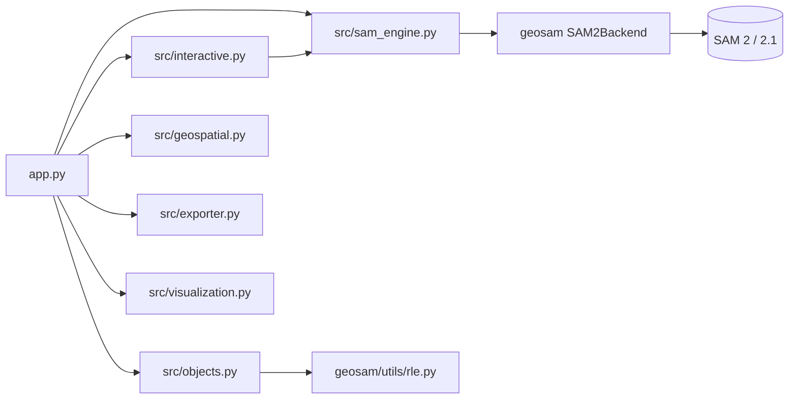

# 🛰️ SAM 2 GeoExtractor

> Segmentación interactiva de objetos en imágenes aéreas y satelitales de alta resolución con **Segment Anything Model 2 (SAM 2)**, convertida en **entidades geoespaciales medibles y exportables**.

La aplicación (Python + Streamlit) descarga una ortofoto georreferenciada (Esri World Imagery), deja segmentar objetos con prompts de SAM 2 (puntos positivos y negativos, cajas, refinamiento iterativo, salida multimáscara y generación automática), los administra como catálogo y calcula sus atributos geométricos en un CRS métrico oficial. Después exporta todo a formatos SIG y a un dataset COCO propio.

---

## Estado verificado (2026-11-15)

| Verificación | Resultado |
|---|---|
| `python test_pipeline.py` | 4/4 ✅ |
| `pytest` (unitarias + integración con **SAM 2 y RemoteCLIP reales**) | 57 ✅ (1 módulo E2E omitido sin `RUN_E2E=1`) |
| `RUN_E2E=1 pytest tests/e2e` (navegador real, teselas reales, SAM 2.1 real) | 5/5 ✅ |
| Rendimiento medido (CPU, 2 vCPU, SAM 2.1 Tiny, mosaico 768×768) | carga 0,6 s · embedding ≈1,9 s · decodificador ≈0,1–0,2 s por prompt |
| Memoria del servidor | ≈0,8 GB con el modelo cargado · pico ≈1,13 GB al calcular el embedding · ≈0,9 GB en reposo |

Detalle de lo terminado y lo pendiente: [`docs/ESTADO.md`](docs/ESTADO.md) · Historial: [`CHANGELOG.md`](CHANGELOG.md) · Decisiones técnicas: [`docs/DECISIONES.md`](docs/DECISIONES.md).

---

## Flujo de trabajo

1. **Zona de estudio**: BBOX en WGS84 y zoom de teselas. La barra lateral muestra la resolución de la imagen y la **resolución efectiva para SAM 2**, porque el modelo reduce toda imagen a 1024×1024 px.
2. **Ortofoto**: descarga concurrente, mosaico georreferenciado en EPSG:3857 y embedding de SAM 2. Si alguna tesela falla, se avisa.
3. **Selección**: clic sobre el mapa. El visor muestra exactamente las teselas procesadas (`max_native_zoom`) y conserva el zoom entre clics.
4. **Segmentación**: un clic produce 3 máscaras candidatas con su **IoU predicho**, y usted elige una.
5. **Refinamiento**: añada puntos ➕ / ➖ o dibuje una ▭ caja con 2 clics. Cada prompt reutiliza los logits de la máscara elegida (`mask_input`). Puede deshacer.
6. **Validación**: elija una categoría (SAM 2 **no clasifica**). Opcionalmente, pida una **sugerencia de RemoteCLIP** (top-3 con probabilidad) y confírmela. Después acepte o descarte.
7. **Objeto geoespacial**: polígono EPSG:4326 con métricas en EPSG:9377 (Colombia) o UTM. En **Forma de la huella** se pueden rellenar patios, unir partes separadas o conservar solo la parte principal. Si el objeto toca el borde de la ortofoto, la app avisa de que puede estar recortado.

> **Edificaciones compuestas (iglesias, conventos, colegios):** un solo clic segmenta solo una parte (un techo o un patio), porque SAM 2 separa regiones visualmente distintas. Use **▭ Caja** alrededor de todo el conjunto, añada **➕** en las partes que falten y active *Rellenar patios*. También puede segmentar por partes y **fusionarlas** en la pestaña Objetos.
8. **Métricas**: área planar y geodésica, perímetro, convex hull, solidez, compacidad, rectangularidad, elongación, orientación, centroide y bbox.
9. **Administración**: tabla editable (visibilidad, etiqueta, estado aceptado/propuesto/rechazado), centrar, refinar (crea una nueva versión), eliminar, estadísticas y relaciones espaciales.
10. **Exportación**: GeoJSON, GeoPackage multicapa, Shapefile, CSV, GeoTIFF (ortofoto y máscaras) y dataset COCO.

### Productos (pestaña 🧩 Productos)

| Producto | Qué entrega | Límite honesto |
|---|---|---|
| Clasificación supervisada (GEOBIA) | Modelo entrenado con sus objetos confirmados; validación (exactitud, kappa, matriz de confusión); clasificación de objetos propuestos | Solo asigna clases que aprendió; necesita 10 o más muestras por clase para ser fiable (≈83 % medido con 71 objetos) |
| Mapa de coberturas | GeoTIFF con paleta + estadísticas m²/% | Cubre solo lo segmentado; el resto queda "Sin clasificar" |
| Cuadro de coordenadas y linderos | Vértices E/N en EPSG:9377, distancias, acimutes; CSV y DXF | Bordes vistos en la ortofoto (aleros), no linderos legales |
| Indicadores urbanos | Índice de ocupación, densidad, área construida, cobertura verde, tipología de cubiertas; por predio o manzana con capa cargada | Sin alturas: no hay pisos ni índice de construcción |
| Informe técnico | HTML imprimible a PDF con metadatos, indicadores, coberturas y validación | Insumo preliminar |

Además, la pestaña Exportar ofrece **DXF** (CAD, Origen Nacional) y **KML** (Google Earth).

### Qué viene de SAM 2 y qué aporta esta aplicación

| Capacidad oficial de SAM 2 | Implementación propia de la app |
|---|---|
| Prompts de puntos (+/−), caja y máscara (`mask_input`) | Historial de prompts, deshacer, caja con 2 clics y regla de cuándo pedir 3 candidatas |
| `multimask_output` + IoU predicho | Selector visual de candidatas |
| `SAM2AutomaticMaskGenerator` | Resultados como objetos *propuestos* para aceptar o rechazar |
| — | Catálogo, versiones, métricas, relaciones espaciales, exportación GIS y dataset COCO |

---

## Arquitectura

```text
app.py                     UI Streamlit (solo orquesta estado y widgets)
config.py                  Constantes, modelos SAM 2/2.1, CRS
src/
├── tile_manager.py        BBOX → teselas XYZ
├── imagery_loader.py      Descarga concurrente con informe de teselas fallidas
├── mosaic_builder.py      Mosaico + transformación afín EPSG:3857
├── sam_engine.py          Pesos compartidos (st.cache_resource), imagen POR SESIÓN, delega en geosam
├── interactive.py         Sesión de prompts de un objeto (puntos, caja, logits, deshacer)
├── postprocess.py         Forma de la huella: patios, unión de partes, parte principal, borde
├── semantic.py            Sugerencia de categoría zero-shot (RemoteCLIP), separada de SAM 2
├── products.py            Clasificación supervisada, coberturas, coordenadas, indicadores, informe
├── objects.py             Catálogo de objetos (RLE, estados, versiones, visibilidad)
├── segmentation.py        Clic ↔ píxel, recortes y superposiciones
├── geospatial.py          Vectorización, CRS métrico, métricas de forma, relaciones espaciales
├── exporter.py            GeoJSON, GPKG, SHP, CSV, GeoTIFF, máscaras, COCO
├── visualization.py       Mapa base estable + capas dinámicas (Folium)
├── highres_loader.py      Fachada retrocompatible
└── classifier.py          NDVI/NDWI (requiere 4 bandas; NO conectado, ver docs/ESTADO.md)
geosam/                    Núcleo independiente de la UI
├── backends/              Protocolo SegmentationBackend, SAM2Backend, MockBackend, SAM3 (esqueleto), caché
├── store/                 Persistencia SQLite con versionado inmutable (aún no conectada a la UI)
└── utils/rle.py           RLE COCO
cli/                       CLI Click (comandos declarados, sin lógica todavía)
tests/
├── unit/                  Rápidas, sin GPU (MockBackend)
├── integration/           SAM 2 real (se omiten si no hay checkpoint)
└── e2e/                   Navegador real con Playwright (RUN_E2E=1)
```



**Concurrencia:** los pesos del modelo se comparten entre usuarios, pero cada sesión guarda su propio `ImageEmbedding`. El backend restaura ese estado bajo un lock antes de cada inferencia; `tests/integration/test_sam2_real.py::test_sessions_do_not_overwrite_each_other` lo comprueba con dos hilos.

---

## Instalación

### Windows (PowerShell)
```powershell
git clone https://github.com/stiagogomezt/sam2project.git
cd sam2project
python -m venv venv
.\venv\Scripts\Activate.ps1
pip install -r requirements.txt
```

### Linux / macOS / WSL
```bash
git clone https://github.com/stiagogomezt/sam2project.git
cd sam2project
python3 -m venv venv && source venv/bin/activate
pip install -r requirements.txt
```

`requirements.txt` instala PyTorch **CPU**. Con GPU NVIDIA, instale antes el `torch` CUDA adecuado desde pytorch.org; la app usa CUDA automáticamente si `torch.cuda.is_available()`.

### Pesos del modelo
Se descargan solos la primera vez (escritura atómica y verificación de tamaño). Por defecto se usa **SAM 2.1 Tiny** (≈156 MB):

| Clave | Checkpoint |
|---|---|
| `sam2.1_hiera_tiny` (por defecto) | https://dl.fbaipublicfiles.com/segment_anything_2/092824/sam2.1_hiera_tiny.pt |
| `sam2.1_hiera_small` | …/092824/sam2.1_hiera_small.pt |
| `sam2.1_hiera_large` | …/092824/sam2.1_hiera_large.pt (requiere GPU en la práctica) |
| `sam2_hiera_tiny/small/large` | …/072824/… (versión original, conservada) |

Variables de entorno opcionales:
- `SAM2_CHECKPOINT_DIR`: carpeta donde guardar o buscar los `.pt` (por defecto, la raíz del proyecto).
- `GEOSAM_MAX_MODELS`: número máximo de modelos SAM 2 retenidos simultáneamente en RAM por `@st.cache_resource` (por defecto `1` para Streamlit Community Cloud; en local con ≥8 GB de RAM puede subirse a `2`; Tiny ≈1,4 GB, Small ≈1,8 GB, Large ≈3,8 GB por entrada).
- `GEOSAM_ALLOW_LARGE_CPU`: definir como `1` para habilitar manualmente variantes *Large* (~856 MB) sin GPU CUDA (deshabilitadas en CPU por defecto).
- `GEOSAM_DISABLE_MOCK=1`: si torch o sam2 faltan, falla en lugar de entrar en modo simulado.
- `REMOTECLIP_DIR`: carpeta del checkpoint `RemoteCLIP-ViT-B-32.pt` (605 MB; se descarga la primera vez que se pide una sugerencia).
- `GEOSAM_DISABLE_SEMANTIC=1`: oculta la sugerencia de categorías (por ejemplo, para ahorrar RAM).

> Sin torch o sam2, la app arranca en **MODO SIMULADO** con un aviso rojo permanente: las máscaras son figuras sintéticas y quedan marcadas como `backend = MockBackend` en el catálogo y en las exportaciones.

---

## Ejecución

```bash
streamlit run app.py
```

## Pruebas

```bash
python test_pipeline.py                 # pipeline geoespacial (sin red ni modelo)
pytest                                  # unitarias + integración con SAM 2 real (si hay checkpoint)
SAM2_TEST_MODEL=sam2_hiera_tiny pytest tests/integration   # otro checkpoint

# Interfaz en navegador real (red + checkpoint):
pip install -r requirements-dev.txt
python -m playwright install chromium
RUN_E2E=1 pytest tests/e2e -v
```

---

## Métricas y sistemas de referencia

- **Nunca** se mide en grados (DEC-0004). CRS métrico: **EPSG:9377** (MAGNA-SIRGAS 2018 / Origen-Nacional) dentro de su área de uso oficial (Colombia continental e insular). Fuera de ella, la zona **UTM** correspondiente.
- `area_m2` y `perimeter_m` son planares en ese CRS; `area_geod_m2` y `perimeter_geod_m` se calculan sobre el elipsoide WGS84. En Bogotá difieren ≈0,1 % por el factor de escala k₀ = 0,9992 de 9377.
- El contorno ráster en escalera sobrestima el perímetro ≈28 %. Por eso se simplifica a **1 px** (Douglas-Peucker): el error de perímetro queda en ≈1 % y el de área por debajo de 1 %. Es configurable en la barra lateral, y `pixel_area_m2` conserva el área exacta de la máscara.
- `pred_iou` es el **IoU predicho por SAM 2** (calidad estimada de la máscara), **no** una probabilidad de clase.

| Atributo | Definición |
|---|---|
| `perimeter_ext_m` | Perímetro exterior (contorno de la huella, sin patios) |
| `compactness` | Polsby-Popper 4πA/P² (1 = círculo) |
| `solidity` | A / A(convex hull) |
| `rectangularity` | A / A(rectángulo mínimo rotado) |
| `elongation` | 1 − ancho/largo del rectángulo mínimo rotado |
| `orientation_deg` | Acimut de cuadrícula del eje largo, horario desde el norte, [0, 180) |
| `gsd_m` | Tamaño real del píxel sobre el terreno |

## Exportación

| Formato | Contenido |
|---|---|
| GeoJSON | Objetos (EPSG:4326) con todos los atributos |
| GeoPackage | Capas `objetos`, `centroides`, `bbox`, `convex_hull`, `rect_min_rotado` |
| Shapefile (.zip) | Campos DBF ≤ 10 caracteres explícitos + `campos.csv` con los nombres completos |
| CSV | Atributos sin geometría |
| GeoTIFF ortofoto | Mosaico RGB en EPSG:3857 |
| GeoTIFF máscaras | uint16: 0 = fondo; cada objeto con su `raster_value` |
| Dataset COCO (.zip) | PNG + `instances.json` (RLE) + `georreferencia.json` (afín + CRS) |
| PNG | Recorte RGBA del objeto seleccionado |

---

## Despliegue en Streamlit Community Cloud

- Archivo principal: `app.py`. Versión de Python probada: 3.13.
- El primer arranque descarga el checkpoint (≈156 MB), y el contenedor puede perderlo al reiniciarse.
- Memoria medida: ≈0,8–1,13 GB con SAM 2.1 Tiny; RemoteCLIP añade ≈600 MB (mapeados del archivo) solo si se usa. SAM 2.1 Large en CPU necesita ≈2,1 GB, así que **no** lo use en Community Cloud. Community Cloud no publica límites fijos; según su foro, una app tiene ≈1 GB garantizado y un máximo de ≈2,7 GB. **Use solo modelos Tiny o Small** en ese entorno.
- La generación automática tarda ≈15 s (8×8 puntos) o ≈35-40 s (16×16) con 2 vCPU.

## Licencia

Código bajo licencia MIT. Modelos y datos con sus propias licencias: ver [`docs/LICENCIAS.md`](docs/LICENCIAS.md) (SAM 2: Apache 2.0; Esri World Imagery: términos de Esri).
